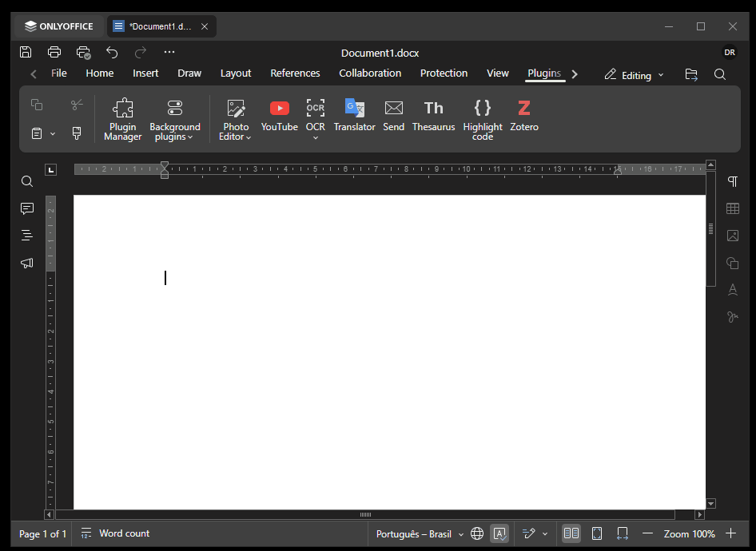
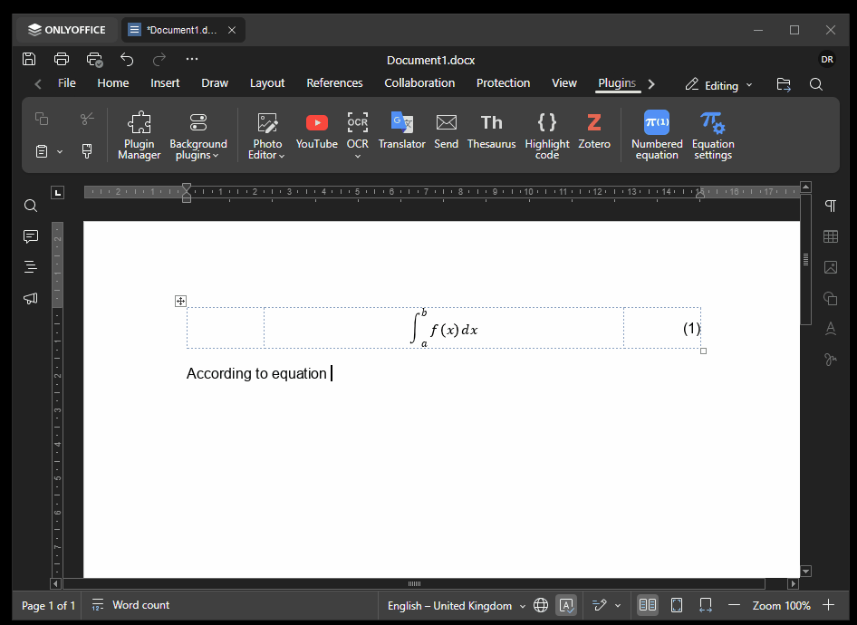
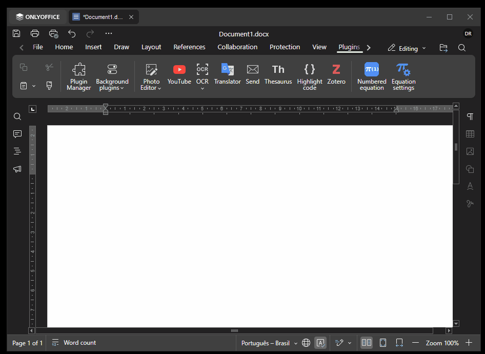
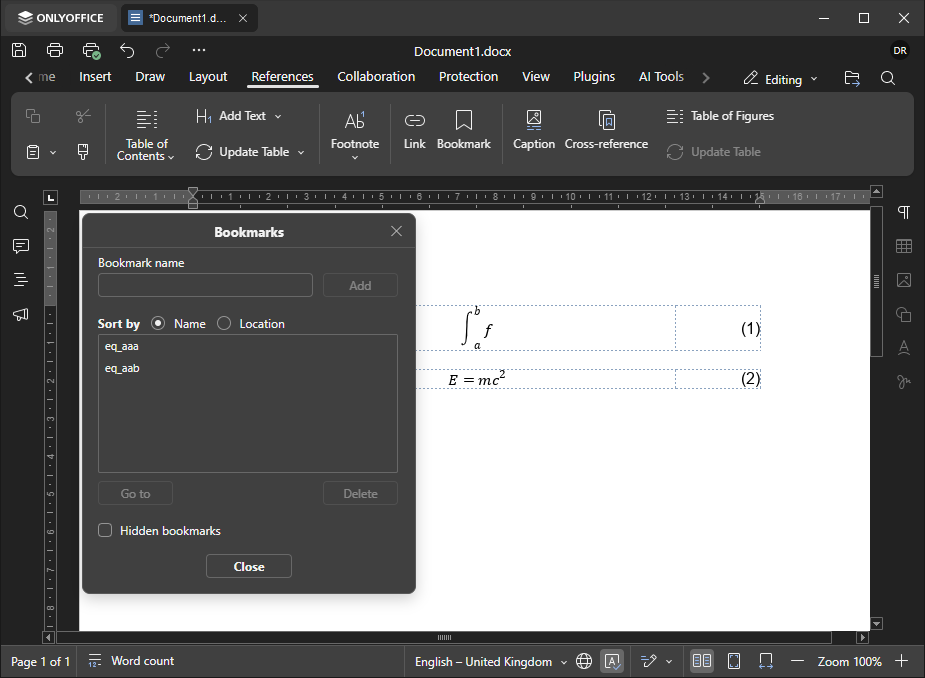
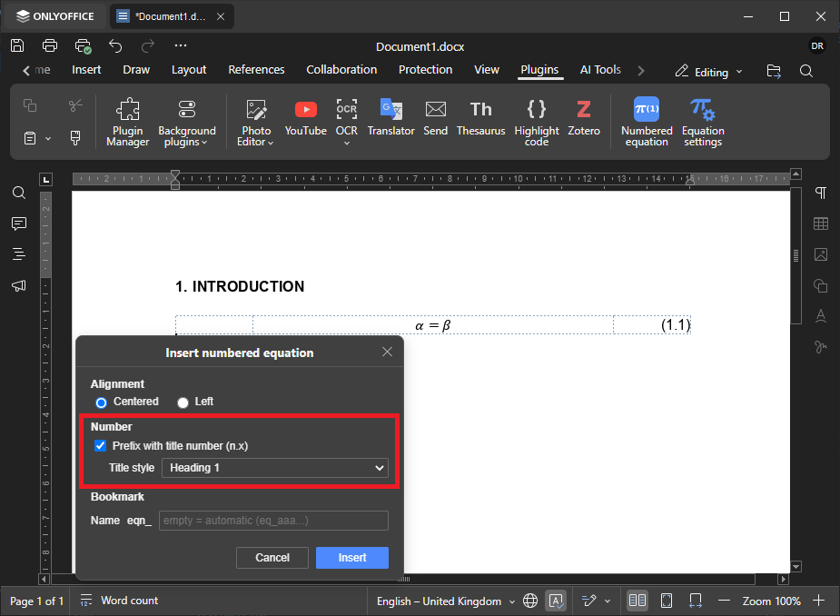
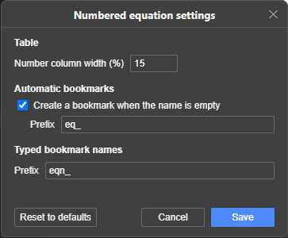

# Numbered equation

## Overview

Insert numbered equations in ONLYOFFICE documents, the way they look in books
and papers: the equation centered (or on the left) and its number on the right
margin.

```
                         E = mc²                         (1)
```

Each equation is placed in a borderless table. The number is made of fields, so
it updates by itself, can be prefixed with the chapter number (`(1.1)`, `(1.2)`,
`(2.1)`...) and works with the editor's own **Cross-reference** dialog.

The plugin works in the Document Editor. It was developed and tested in
ONLYOFFICE Desktop Editors 10.

## Features

- **Two buttons in the Plugins tab**: "Numbered equation" and "Equation
  settings".
- **Centered or left-aligned equation**, with the number always on the right.
- **Automatic numbering** with a `SEQ Equation` field, the same sequence used by
  ONLYOFFICE equation captions.
- **Chapter prefix (optional)**: numbers like `(1.1)` using a `STYLEREF` field
  to the title style you choose (Heading 1 by default). The equation count
  restarts in each chapter.
- **Bookmark around the number**, created automatically (`eq_aaa`, `eq_aab`...)
  or with a name you type.
- **Cross-references** with the built-in dialog: References → Cross-reference →
  Reference type "Equation".
- **Keyboard**: Enter inserts, Esc closes the window.
- **Light and dark themes** supported.

## How to use

1. Place the cursor on an **empty line** (outside any table).
2. Open the **Plugins** tab and click **Numbered equation**.
3. Choose the options and click **Insert** (or press Enter):
   - **Alignment**: Centered or Left.
   - **Number → Prefix with title number (n.x)**: adds the chapter number from
     the selected **Title style**.
   - **Bookmark → Name**: leave it empty for an automatic name, or type one.
4. Type your equation. The cursor is already inside it.



If the buttons do not appear, check that the plugin is turned on in **Plugins →
Background plugins**.

## Cross-references

The number can be referenced like any other equation caption:

1. Go to **References → Cross-reference**.
2. Set **Reference type** to **Equation** and choose the number.
3. Click **Insert**.



### Bookmarks

You can also give the number a bookmark: type a name in the **Name** field of
the insert window. The bookmark is listed in **References → Bookmark**:



### Automatic bookmark names

By default, each number gets an automatic bookmark, using **letters, not
numbers** (`eq_aaa`, `eq_aab`...). The letters only keep the creation order. A
new name never repeats an existing one.



You can use this feature to change the bookmark name later: bookmarks cannot be
renamed, but you can create a new one in the same location and delete the old
one.

### Chapter numbers

To number the equations by chapter, such as `(1.1)`, `(1.2)`, `(2.1)`, check
**Prefix with title number (n.x)** in the insert window and choose the **Title
style** of your chapters. The title style must have list numbering. The equation
count restarts in each chapter.



## Settings

Click **Equation settings** in the Plugins tab. The settings are saved on your
computer, not in the document.



| Setting                                  | Default | Description                                                                                               |
| ---------------------------------------- | ------- | --------------------------------------------------------------------------------------------------------- |
| Number column width (%)                  | 15      | Width of the number column, as a percentage of the page text width (1 to 49). The equation gets the rest. |
| Create a bookmark when the name is empty | On      | If off, an empty name means no bookmark.                                                                  |
| Automatic prefix                         | `eq_`   | Prefix of the automatic bookmarks: `eq_aaa`, `eq_aab`, ... `eq_zzz`.                                      |
| Typed names prefix                       | `eqn_`  | Added before the names you type (`Energy` → `eqn_Energy`). Can be empty.                                  |

**Reset to defaults** restores these settings and the last choices of the insert
window.
